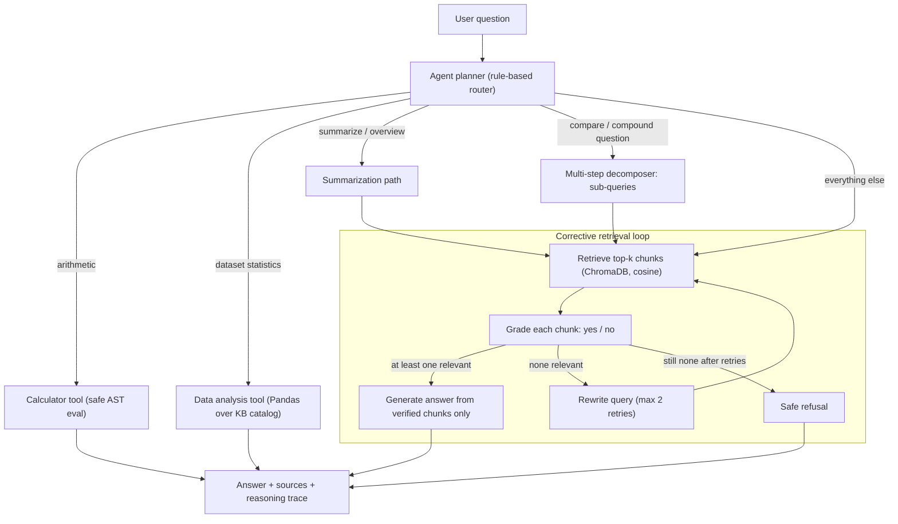

# Agentic & Corrective RAG System for Course Q&A


A lightweight, CPU-friendly **Agentic Retrieval-Augmented Generation (RAG)** system that answers student questions from course materials in four formats (**PDF, DOCX, CSV, TXT**). An agent plans before answering, picks the right tool, checks the quality of every retrieved chunk, rewrites weak queries, and refuses to answer when the knowledge base has no evidence, which reduces hallucination.

The project combines two course assignments into one pipeline: **Corrective RAG** (grade retrieved context, rewrite the query, answer from verified context only) and **Agentic RAG** (plan, use tools, handle multi-step questions). It runs end to end on a free Kaggle CPU notebook with models between 77M and 500M parameters, and ships with a **Gradio** web app that has model selection, a reasoning trace, a data viewer, file upload and a built-in benchmark.

## Table of contents

- [Key features](#key-features)
- [Architecture](#architecture)
- [Repository structure](#repository-structure)
- [Quick start](#quick-start)
- [Using the Gradio app](#using-the-gradio-app)
- [Dataset](#dataset)
- [Evaluation and results](#evaluation-and-results)
- [Known limitations](#known-limitations)
- [Project requirements coverage](#project-requirements-coverage)
- [Roadmap](#roadmap)
- [License](#license)

## Key features

| Area | What the system does |
|---|---|
| **Ingestion pipeline** | Extracts text from PDF (per page), DOCX (per heading section), CSV (per row) and TXT, cleans it, splits it into sentence-aware chunks (up to 500 characters, 1 sentence overlap), embeds it with `all-MiniLM-L6-v2` and stores it in a persistent ChromaDB collection with metadata (course, file, type, part). |
| **Agent planner** | A rule-based router inspects each question and chooses an execution path before any retrieval happens: calculator, data analysis, summarization, multi-step retrieval or corrective retrieval. |
| **Corrective retrieval loop** | Retrieves top-k chunks, grades each one with the LLM (`yes` / `no`, deterministic decoding), skips very low-similarity chunks without calling the LLM, rewrites the query when no chunk is relevant (maximum 2 rewrites), and returns a clear refusal when nothing is verified. |
| **Multi-step questions** | Compound or comparative questions are split into sub-queries, and each one is retrieved and graded separately. |
| **Tools** | `calculator_tool` (safe AST-based arithmetic), `data_analysis_tool` (Pandas statistics over the knowledge base), summarization, and `kb_search_tool` (the corrective loop). |
| **Grounded answers with sources** | The generator only sees verified chunks. Every answer lists its sources (file, course, format, page or part). Empty or malformed model outputs are cleaned, retried, or replaced by an extractive fallback. |
| **Standard vs. agentic mode** | Both pipelines are implemented, so they can be compared on the same test set. |
| **Model choice** | Three CPU models are benchmarked. The best one is saved to disk and is the default in the UI, and the user can switch models from a dropdown. |
| **Gradio deployment** | Three-tab web app with a public share link, live reasoning trace, original data viewer, document upload and a one-click 15-question test run. |

## Architecture



### How the planner routes a question

The planner is a deterministic, ordered rule set (see `plan_agent_strategy` in `agentic_rag.py`). The LLM is used for chunk grading, query rewriting, summarization and answer generation, not for choosing the route.

| Order | Strategy | Triggered by | Example |
|---|---|---|---|
| 1 | `calculator` | An arithmetic expression plus a word such as *calculate*, *compute*, *what is* | `Calculate 40 / (40 + 10)` |
| 2 | `data_analysis` | Phrases such as *how many files*, *how many chunks*, *file types*, *list all courses* | `How many files and total chunks are in the dataset?` |
| 3 | `summarize` | *summarize*, *summary of*, *overview of*, *key takeaways* | `Summarize the Python course` |
| 4 | `multi_step_rag` | *difference between X and Y*, *compare X and Y*, or a long question joined by "and" | `Who teaches the SQL course and how is it graded?` |
| 5 | `corrective_rag` | Everything else (default) | `What does the learning rate control in gradient descent?` |

### Models

| Model | Parameters | Role |
|---|---|---|
| `sentence-transformers/all-MiniLM-L6-v2` | ~22M | Embeddings (384 dimensions) |
| `google/flan-t5-small` | ~77M | Candidate LLM (fastest) |
| `google/flan-t5-base` | ~250M | Candidate LLM (balanced) |
| `Qwen/Qwen2.5-0.5B-Instruct` | ~500M | Candidate LLM (instruction-tuned) |

Everything runs on CPU. Models are downloaded once, and the winning model is saved to `best_llm/` so the app can load it offline.

## Repository structure

```text
Agentic-RAG-System/
├── notebooks/
│   └── agentic-rag-system.ipynb   # Full Kaggle notebook (build, benchmark, deploy)
├── ingestion.py                   # Extract, clean, chunk, embed, store; catalog helpers
├── agentic_rag.py                 # Planner, tools, corrective loop, LLM registry, generation
├── gradio_app/
│   ├── app.py                     # Gradio web application (3 tabs)
│   └── best_model.json            # Winning model name + ranking (written by the notebook)
├── course_materials/              # Generated sample dataset (3 courses, 4 file types)
├── test_set.csv                   # 15-question evaluation set
├── evaluation_details.csv         # Per-question benchmark results
├── run_local.py                   # Builds the vector store and starts the Gradio app
├── Dockerfile                     # Container image (exposes port 7860)
├── requirements.txt
└── .gitignore
```

Generated at run time and intentionally not committed: `chroma_db/` (vector store), `best_llm/` (model weights), `*.log`, `*.zip`.

## Quick start

### Run on Kaggle (recommended)

1. Create a new Kaggle notebook and import `notebooks/agentic-rag-system.ipynb`.
2. In the notebook settings, set **Accelerator = None (CPU)** and **Internet = On**. Internet is needed once, to install packages and download the models.
3. Click **Run All**. The notebook installs dependencies, writes `ingestion.py` and `agentic_rag.py`, generates the dataset, builds the vector store, runs the demo, benchmarks the three models, saves the best one and starts the app.
4. The last launch cell prints a public URL such as `https://xxxxxxxx.gradio.live` (the app also listens on port `7860`). Share links are temporary (best effort, up to about one week).

The slowest cell is the benchmark, because `Qwen2.5-0.5B` is much slower than the T5 models on CPU.

The final cells are optional helpers that package the project and push it to GitHub. They read a `GITHUB_TOKEN` from **Kaggle Secrets**, so never paste a token into the notebook or commit it.

### Run outside Kaggle

The scripts use `/kaggle/working` as the base folder (`BASE_DIR` in `ingestion.py`). To run elsewhere:

```bash
git clone https://github.com/mohamedelneelkhater-oss/Agentic-RAG-System.git
cd Agentic-RAG-System
python -m venv .venv && source .venv/bin/activate   # Windows: .venv\Scripts\activate
pip install -r requirements.txt

# 1. Change BASE_DIR at the top of ingestion.py to this project folder
# 2. Then build the vector store and launch the UI:
python run_local.py
```

Or with Docker (the container serves the app on port 7860):

```bash
docker build -t agentic-rag .
docker run -p 7860:7860 agentic-rag
```

> The local and Docker paths are provided as a convenience and have not been verified outside Kaggle. See [Known limitations](#known-limitations).

## Using the Gradio app

**Tab 1: Agentic RAG Q&A Assistant**

- **Model dropdown:** pre-selected with the best model from the benchmark, switchable between `flan-t5-small`, `flan-t5-base` and `qwen2.5-0.5b-instruct`.
- **Mode toggle:** *Agentic + Corrective RAG* or *Standard baseline RAG*, to compare behaviour on the same question.
- **Controls:** course filter, number of retrieved chunks (`top_k`) and maximum query rewrites.
- **Reasoning trace:** shows the planner decision, tool used, per-chunk relevance grades, query rewrites, the final decision, sources and latency.

**Tab 2: Original dataset and document upload**

- Original file catalog, the original CSV glossary, the raw TXT syllabi and the processed chunks table.
- Upload your own `.pdf`, `.docx`, `.csv` or `.txt` files. They go through the same ingestion pipeline and become searchable immediately.

**Tab 3: Test set and model benchmark**

- The 15-question test set and the benchmark leaderboard.
- A **Run 15-Question Test Set Live** button that evaluates the selected model inside the UI.

<!-- Screenshots: add images to docs/screenshots/ and uncomment, for example:


-->

### Example questions

| Type | Question |
|---|---|
| Direct | What does the learning rate control in gradient descent? |
| Direct | What is a primary key in SQL? |
| Vague (needs rewriting) | how can i stop my model from memorizing the training data? |
| Multi-step | Who teaches the Python course and how is it graded? |
| Tool: data analysis | How many files and total chunks are in the dataset? |
| Tool: calculator | Calculate 40 / (40 + 10) |
| Out of scope (must refuse) | What is the final exam date of the SQL course? |

## Dataset

The dataset is generated by the notebook, so no download is required and the results are reproducible. The course content is fictional sample material written for this project.

| Course | Files | Formats |
|---|---|---|
| Machine Learning | `ml_lecture_notes.pdf`, `ml_syllabus.txt` | PDF, TXT |
| Python Programming | `python_lectures.docx`, `python_syllabus.txt` | DOCX, TXT |
| SQL and Databases | `sql_glossary.csv`, `sql_syllabus.txt` | CSV, TXT |

Six files become **29 chunks** (Machine Learning 7, Python Programming 7, SQL and Databases 15). The notebook also packages everything as `course_materials.zip`. To publish it as a reusable **Kaggle Dataset**, click **Save Version**, open the **Output** tab and choose **New Dataset** on `course_materials/`.

<!-- Add the published Kaggle dataset link here -->

## Evaluation and results

### Test set

`test_set.csv` contains 15 hand-written questions:

| Category | Count | Purpose |
|---|---|---|
| Direct (PDF, TXT, DOCX, CSV) | 9 | Basic retrieval across all formats and courses |
| Vague / paraphrased | 2 | Query rewriting |
| Multi-step | 1 | Decomposition into sub-queries |
| Agent tool | 1 | Data analysis tool |
| Unanswerable | 2 | Hallucination control (the system must refuse) |

**Scoring.** For answerable questions the score is the fraction of expected keywords found in the answer (0 if the system refused). For unanswerable questions it is 1 if the system refused and 0 if it answered. *Context hit* checks whether the expected source file reached the generator. The **final score** used to pick the deployed model is `0.8 × quality + 0.2 × speed_score`, where `speed_score` is the fastest model's latency divided by the model's own latency.

### Standard RAG vs. Agentic Corrective RAG (CPU, one run)

| Model | Mode | Quality | Context hit | Refusal rate | Avg latency (s) |
|---|---|---|---|---|---|
| flan-t5-small | Standard | 0.600 | 0.923 | 0.5 | 0.89 |
| flan-t5-small | Agentic corrective | 0.733 | 1.000 | 1.0 | 1.15 |
| flan-t5-base | Standard | 0.800 | 0.923 | 0.5 | 1.52 |
| flan-t5-base | Agentic corrective | **0.867** | 0.846 | 1.0 | 3.10 |
| qwen2.5-0.5b-instruct | Standard | 0.733 | 0.923 | 0.5 | 5.09 |
| qwen2.5-0.5b-instruct | Agentic corrective | **0.867** | 1.000 | 0.5 | 12.69 |

### Model ranking (agentic corrective mode)

| Rank | Model | Quality | Avg latency (s) | Final score |
|---|---|---|---|---|
| 1 | **flan-t5-small** (deployed default) | 0.733 | 1.15 | 0.787 |
| 2 | flan-t5-base | 0.867 | 3.10 | 0.768 |
| 3 | qwen2.5-0.5b-instruct | 0.867 | 12.69 | 0.711 |

**Takeaways**

- The agentic corrective pipeline improved quality for all three models and raised the refusal rate on unanswerable questions from 0.5 to 1.0 for both T5 models.
- `flan-t5-small` is the default because the composite score rewards speed. `flan-t5-base` and `Qwen2.5-0.5B` score higher on quality (0.867), so if answer quality matters more than latency, select one of them in the dropdown or increase the quality weight in the ranking formula.
- `Qwen2.5-0.5B` still answered one of the two unanswerable questions, and it is roughly 4 to 11 times slower than the T5 models on CPU.
- With only 15 questions, one question equals about 6.7 percentage points. Treat the differences as indicative, not statistically conclusive.

## Known limitations

- **The planner is rule-based.** Routing uses regular expressions and keyword lists, so unusual phrasings can be routed to the default path. A learned or LLM-based planner would be more flexible, but it is unreliable with models this small.
- **Decomposition is heuristic.** "Difference between X and Y" is turned into "What is X?" and "What is Y?". This can fail when X and Y are not standalone concepts. In the demo run with `flan-t5-base`, *"What is the difference between a list and a tuple in Python?"* was split this way and the system refused to answer.
- **The data analysis tool reports knowledge-base statistics** (files, chunks, formats, chunks per course). It does not analyse domain data inside the documents.
- **Scoring is keyword-based.** A correct answer phrased differently can be marked wrong, and the sample data is small and synthetic.
- **Small models make mistakes.** They can copy the wrong sentence from a relevant chunk, and the LLM grader can reject a relevant chunk.
- **Paths are set for Kaggle.** `ingestion.py` and `gradio_app/app.py` reference `/kaggle/working`. The local and Docker routes need `BASE_DIR` changed first and were not verified outside Kaggle.
- **Share links expire.** Gradio `share=True` links are temporary.

## Project requirements coverage

| Requirement (Agentic RAG project) | Implementation |
|---|---|
| Prepare multiple documents and build a knowledge base | 3 courses, 4 file formats, ChromaDB index |
| Processing pipeline: extraction, cleaning, chunking, embeddings, storage | `ingestion.py` |
| Agent that understands the question and decides when to search | `plan_agent_strategy` and the strategy branches in `run_agentic_rag` |
| Refine queries, compare information, generate answers with sources | Query rewriting, sub-query decomposition, source labels on every answer |
| Tools: search, summarization, data analysis, calculation | `kb_search_tool` (corrective loop), summarization path, `data_analysis_tool`, `calculator_tool` |
| Support complex multi-step questions | `decompose_multi_step` |
| Standard RAG vs. Agentic RAG | `agentic=False` baseline and the benchmark above |
| Deploy with Gradio | `gradio_app/app.py` with public share link |

## Roadmap

- Extend the test set beyond 15 questions and add an answer-quality judge that does not rely only on keywords.
- Improve decomposition for comparison questions (retrieve each concept with its context instead of "What is X?").
- Add a data-analysis tool over domain tables (for example grades or course statistics), not only knowledge-base metadata.
- Add citations at sentence level and an option to export a session report.
- Publish the app on Hugging Face Spaces for a permanent link.

## License

No license has been added yet. Add a `LICENSE` file (for example MIT) before others reuse the code.
